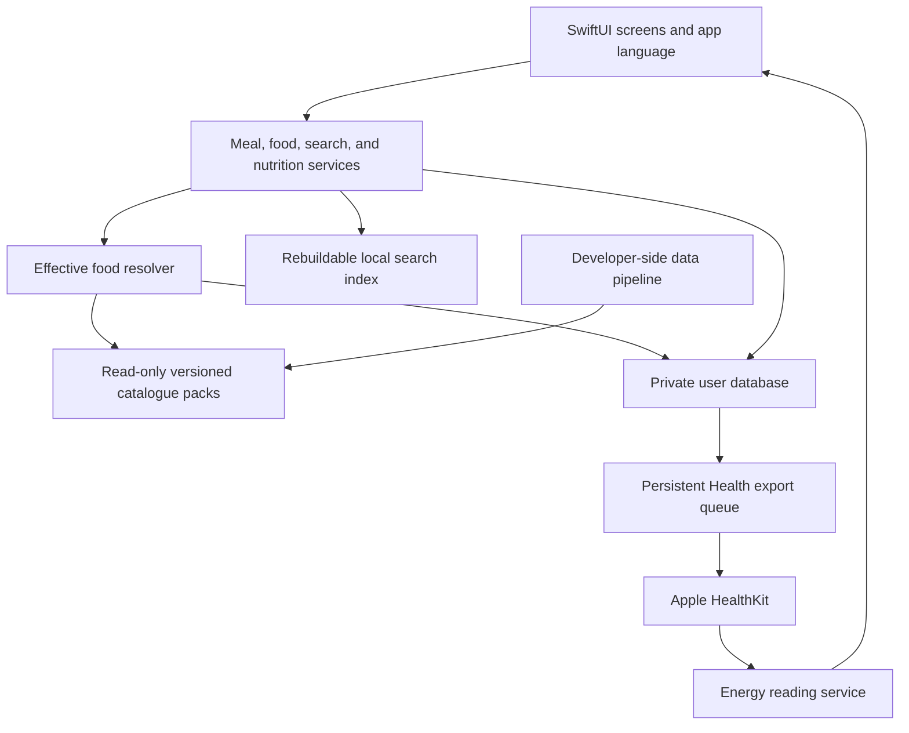

# Product and architecture plan

Planning baseline: 10 October 2026. Proposed decisions are defaults for implementation, not additional requirements already approved by the user. External requirements and source terms must be rechecked before release.

## 1. Product outcome and first-release scope

Build an iPhone app that makes it quick to record what someone ate, see nutritional totals, and compare recorded food energy with energy expenditure reported by Apple Health. It must work immediately after installation without an account, server connection, or initial food download.

| Requirement | First-release behavior |
| --- | --- |
| iOS application | Native iPhone app using Swift and SwiftUI; proposed minimum iOS 18, confirmed in A01 against intended devices and required APIs |
| Local operation | Search, diary, recipes, ingredients, products, customizations, and calculations work offline |
| Apple Health reading | Optional access to active energy and resting/basal energy |
| Apple Health writing | Optional export of recorded dietary energy and supported nutrients, including corrections and deletions |
| Meal categories | Breakfast, lunch, dinner, snack; suggested from the selected eating time |
| Reusable foods | Generic ingredients, branded products, recipes, and saved meal combinations |
| Personal editing | Customize a catalogue item, create a separate variation, or create a new item |
| Built-in content | Swedish-first generic foods, German generic foods, branded products in both markets, and editable starter meals |
| Language | Explicit in-app choice of Svenska, English, or Deutsch, independent of phone language |
| Country discovery | Visible country-listing badges and filters, with separate actual-origin information when known |
| Visual design | Colorful accents, clear hierarchy, accessible typography, light and dark appearance |
| Data durability | Versioned storage, safe migrations, recoverable catalogue activation, and a documented local backup/restore route |

Defer accounts, cloud synchronization, Android, Apple Watch app, social sharing, subscriptions, AI food recognition, automatic diet advice, and live online food lookup. Barcode scanning is a useful later increment; barcode identifiers should exist in the initial data model. Initial release should include manually searchable products without requiring a scanner.

This is a tracker, not a weight-loss prescription. Do not silently turn energy expenditure into an intake recommendation. A user-defined daily target can be a later feature; core energy reporting does not depend on it.

## 2. Main journeys and interface

Use three primary tabs: **Today**, **Foods**, and **Settings**. Put history behind the date selector in Today. A prominent Add meal action should be reachable from Today with one tap.

### Today and history

Present the selected day, a concise energy summary, protein/carbohydrate/fat totals, and four meal sections. Each meal entry shows its time, a short title, energy, and an unobtrusive Health export status where attention is needed. Multiple entries may belong to the same meal category.

The energy summary distinguishes **Eaten**, **Active energy**, and **Resting energy**. Total reported expenditure appears only when both components are available. Today's figures say “so far”; historic figures can still be incomplete if the source device was not worn or synchronized.

Use a compact energy comparison rather than implying that a progress ring is a recommended eating allowance. Do not use red to shame someone for eating more, skipping a meal, or having incomplete data.

### Log a meal

1. Open Add meal. Default the date and time to now when on today. On a past day, use that selected date and the current local clock time, show both prominently, and allow correction.
2. Suggest the meal category from that selected time; opening Add within a particular category counts as an explicit category choice.
3. Search foods or choose recent items, favorites, recipes, or saved meals.
4. Select a food and enter grams, millilitres where supported, or a defined portion.
5. Show the running meal totals and any incomplete nutrient information.
6. Save locally immediately. If enabled, queue Apple Health export separately.
7. Offer Edit, Duplicate to another time, Save as reusable meal, and Delete from the saved entry.

Recommended default suggestion windows, using the selected eating time's local clock:

| Local time | Suggestion |
| --- | --- |
| 05:00–10:59 | Breakfast |
| 11:00–14:59 | Lunch |
| 17:00–20:59 | Dinner |
| All other times | Snack |

Allow these windows to be edited in Settings. Reject overlapping windows; uncovered time defaults to snack. Recompute the suggestion when the eating time changes only while the category is still automatic. Once the user picks a category, retain it until they select “Use suggestion.” Do not infer from save time after the eating time was changed.

Drafts survive accidental navigation or app suspension. Cancelling a draft never writes to Health. A future time is a draft until confirmed as eaten; meal planning is outside the initial scope.

### Foods and reusable meals

Foods includes search plus views for ingredients, products, recipes, saved meals, favorites, and My foods. A recipe is a prepared dish with ingredients and yield. A saved meal is a reusable combination of foods and amounts, such as bread, cheese, coffee, and milk. Logging either creates a historical snapshot.

Food details show name, brand where applicable, country listing, preparation state, nutrition basis, portions, source, source date, and whether the item is customized. A food with unknown energy remains editable but cannot produce an apparently complete energy total.

Editing actions must be explicit:

| Action | Meaning |
| --- | --- |
| Adjust this meal only | Change an amount or food within one logged event; do not edit the reusable food |
| Customize this food | Create or modify the personal overlay for a catalogue item |
| Create a variation | Create an independent personal item, retaining optional source attribution |
| Create from scratch | Create a personal ingredient, product, recipe, or saved meal |
| Reset a field | Remove that field's override and inherit the current catalogue value |
| Reset all customizations | Remove that item's overlay after showing what changes |

### Visual direction

Use a neutral warm background, generous spacing, rounded cards, and four restrained meal accents: amber for breakfast, teal for lunch, violet for dinner, and coral for snacks. Use text and icons alongside color. Nutrient colors must remain consistent across screens.

Keep the first screen focused on today's meals. Put detailed micronutrients, data sources, and customization history one level deeper. Avoid decorative graphs or product photographs that increase visual noise and app size.

Design for Dynamic Type, VoiceOver, sufficient contrast, reduced motion, dark appearance, and at least 44-point touch targets. A country flag must have a country name and accessible label; emoji rendering alone is insufficient. German labels and long product names must wrap without hiding quantities or the save action.

## 3. Language, region, and country semantics

First launch displays a compact language choice. Offer Swedish as the highlighted default because the product is Swedish-first, but persist an explicit selection. Every app-owned screen, error, unit label, plural, accessibility label, and notification must use that preference.

Treat these settings independently:

| Setting | Controls |
| --- | --- |
| App language | UI copy, search display names, formatting conventions |
| Preferred food market | Search ranking and initial country filter; Sweden initially, with Germany and All available |
| Time zone | Defaults to device time zone; explicitly recorded with meal events |
| Energy unit | kcal initially; optional kJ display |

Use String Catalogs and a central locale-aware localization service. Set the SwiftUI locale and use explicit locales for non-view formatting. Do not rely on globally changing the phone language or unsupported runtime bundle tricks. A language change updates the interface and search display without restarting or losing a draft.

System-owned sheets, keyboards, permission dialogs, and the Health app may continue to follow iOS settings. Localize the provided Health permission-purpose strings in the app bundle, and verify the actual system behavior on devices; the app cannot promise to control all operating-system UI.

Translate generic food names and descriptors. Preserve official product names and brands, adding translated category descriptors and search aliases. Fallback order: chosen language, source name, English if available. Never show a missing-localization key.

Swedish “kolhydrater,” English “carbohydrate,” and German “Kohlenhydrate” must reference the same defined nutrient concept. “Fett” and “fat” must not become separate data fields.

### Country badges

Store and display these as different concepts:

| Field | Meaning | Example label |
| --- | --- | --- |
| Market/listing countries | Countries in whose food market the product is listed | 🇸🇪 Listed in Sweden |
| Manufacturing countries | Verified location of production | Made in Germany |
| Ingredient origins | Verified origin of ingredients, potentially several places | Pork origin: Sweden |
| Brand country | Brand association, when reliably sourced | Brand country: Sweden |
| Cuisine/reference country | Cultural association or generic reference dataset | Swedish dish; German reference food |

This distinction is necessary because Open Food Facts defines countries as sales countries, origins as ingredient origins, and manufacturing places separately. A Swedish listing does not establish Swedish manufacture. See the [official field definitions](https://github.com/openfoodfacts/openfoodfacts-server/blob/main/html/data-fields.txt).

Search results should satisfy the requested flag behavior with an explicitly labelled listing badge. Searching Falukorv ranks relevant Swedish listings highly; it does not exclude a genuinely relevant German listing. Products in both markets show both badges. Unknown origin says “Origin not specified,” without inventing a flag. An optional “Made in” filter is available only for verified manufacturing data and remains distinct from the main market filter.

## 4. Technical architecture

Recommended baseline: Swift, SwiftUI, structured concurrency, SQLite through GRDB, native HealthKit, and local full-text search. GRDB is a SQLite toolkit distributed under MIT; pin a compatible release after checking the selected deployment target. This choice provides explicit migrations and control over the separation of catalogue and personal storage. See the [GRDB repository](https://github.com/groue/GRDB.swift).

Avoid requiring a production backend. Developer-side food-data preparation is a separate build process and may use internet access; the shipped app consumes its already-built artefacts.

Use modules with narrow responsibilities: Domain, Persistence, Catalog, Nutrition, Search, HealthIntegration, Localization, DesignSystem, and feature modules for Diary, Foods, and Settings. Domain types must not import UI or HealthKit frameworks. Screen code must not issue raw database writes or perform nutrient arithmetic independently.

Use one serialized writer for the user database. Resolve and pin a catalogue generation for each meal-save operation so a catalogue change cannot mix two versions within one snapshot. A single dependency-composition owner wires repositories and feature services together.

Proposed storage areas:

| Store | Contents | Lifecycle |
| --- | --- | --- |
| Catalogue packs | Immutable public source foods, translations, portions, recipes, licences, and revisions | Replaced as validated generations |
| User database | Overrides, custom foods, favorites, recipe pins, logs, snapshots, settings, Health ledger/outbox | Never replaced by a catalogue update |
| Derived index/cache | Search documents and resolved projections | Rebuildable; contains private names and must receive equivalent protection |
| Health energy cache | Minimal dated totals and freshness metadata, only if needed | Rebuildable from authorized Health reads |

Ship catalogue updates within app releases for version 1. Optional downloadable, signed catalogue-only updates can follow later. This avoids a required network service and keeps first-install offline behavior predictable.

## 5. Shared domain contract

The first agent must turn this conceptual model into agreed interface and schema specifications before other agents create competing representations. This section is a plan, not executable schema.

| Entity | Required concepts |
| --- | --- |
| Food identity | Stable internal identifier; kind; source namespace and record ID; catalogue revision; lifecycle status |
| Food description | Localized names, aliases, brand, category, preparation state, market countries, verified origin fields |
| Nutrition profile | Reference quantity and unit; nutrient values and units; carbohydrate definition; value status; source/provenance |
| Nutrient value | Numeric value when known; known-zero, unknown, trace, or derived status; optional uncertainty; evidence |
| Portion | Stable ID; localized name; mass or volume equivalent; whether measured or estimated |
| Recipe | Stable component IDs; referenced foods/revisions; quantities; servings; optional cooked yield mass; calculation version |
| Saved meal | Stable component IDs and quantities; preferred category if user-selected; no cooking-yield transformation |
| Override | Target ID; schema version; field operations; original base revision; edit revision and timestamp |
| Custom food | User UUID; complete authored data; optional lineage to a source item |
| Logged meal | UUID; event revision; eaten-at instant; time zone; local diary date; meal category; component snapshots |
| Snapshot | Original IDs/revisions; effective name/profile/portion; resolved quantity; nutrient totals/status; calculation version |
| Health ledger | Meal UUID; nutrient type; desired revision; sync identifier/version; exported UUIDs; status and errors |
| Outbox operation | Stable operation identity; desired action; current generation; retry metadata; completion state |
| Catalogue manifest | Pack ID/version; schema version; source versions; checksums; counts; attribution; compatibility range |

Stable IDs must not be based only on a food's translated name or barcode. Retain source namespaces. Barcodes are searchable text aliases that preserve leading zeros, with product-variant and reformulation handling. Cross-source equivalence is an explicit reviewed mapping, not an automatic name match.

Repository/service contracts must cover: search; resolve effective food; save/reset overlay; save personal food; calculate a portion/recipe/meal; save/edit/delete log; activate catalogue; read energy; reconcile Health export; choose language; export/restore personal data. Each defines ownership, input/output shapes, error cases, cancellation behavior, and change notifications.

## 6. User customizations and catalogue updates

### Resolution rules

For each overridable field, distinguish three states: **inherit**, **set a value**, and **explicitly clear**. Empty text, zero, unknown nutrition, and inheritance must remain distinguishable.

Effective value = explicit personal override when present, otherwise the current base value. Catalogue imports never write to override or personal-food tables. Catalogue changes may update inherited fields but cannot erase an override.

Record the base value/revision when the user edits a field. If that underlying value later changes, retain the user's value and offer “Updated source available” with a comparison. This is informational and must not block logging. Structural conflicts that could invalidate a recipe or nutrition basis require review while preserving the last usable personal version.

Treat related fields coherently. Changing the reference basis from 100 g to 100 ml cannot leave old numeric nutrient overrides attached as though nothing changed. Define nutrition-basis changes as a grouped operation, converting only with an explicit conversion or preserving the former personal profile for review.

Localized names are overridden per language. Recipe components use stable component IDs. Amount changes, removed components, and user-added components are separate operations. Deleting a base component must not cause a personal change to attach to the next array position. Preserve an edited removed component as a personal component when its reference remains valid; otherwise mark the recipe for review and retain its saved version.

### Example update behavior

All numbers here are synthetic test fixtures.

| Change | Result |
| --- | --- |
| Base energy is 200 kcal/100 g; user sets 215; next catalogue changes base to 205 | Effective energy remains 215 |
| User overrides only the name; base protein changes from 10 to 11 g/100 g | Personal name remains; protein becomes 11 for future use |
| User explicitly clears a portion label; source adds a new label | The cleared label remains cleared |
| User removes one component from a starter recipe; source reorders the recipe | The same stable component remains removed |
| Source retires an item used by a personal recipe | Recipe retains a resolvable archived dependency and shows its retired status |
| User resets energy to catalogue | The current 205 value is inherited; the old override is removed |

### Protecting history and personal recipes

Every logged meal stores the fully resolved values actually used. Do not recalculate history when a catalogue, translation, portion, recipe, or calculation algorithm changes. Editing an old meal initially uses its stored snapshot; “Refresh from current food data” is a separate explicit action. Changing its quantity scales that snapshot unless the user replaces or refreshes the item.

Personal recipes and saved meals pin the resolved component revisions accepted when saved. Offer a review action to refresh components from current data. This prevents a frequently used personal meal from silently changing because a branded product was reformulated. Current generic catalogue items may inherit catalogue improvements for new direct logs.

Catalogue retirement uses tombstones plus retained revisions for dependencies; it is not destructive deletion. Preserve enough referenced data to survive the removal of an entire source pack. If rights later require removal of a public source, handle that through a separate reviewed migration and retained personal snapshots as permitted, rather than silently deleting diary entries.

### Safe catalogue activation

1. Stage the new immutable generation and validate compatibility, schema, IDs, references, checksums, and licence manifest.
2. Check retired/rekeyed records against personal dependencies; preserve required archived data.
3. Build an index for the new generation and current overlay revision, or prepare a documented searchable fallback.
4. Activate the generation through an atomic pointer/state change. Store generation IDs in caches and open sessions.
5. Reapply overlays through the resolver; do not copy new base values over user data.
6. On interrupted activation, keep or return to the prior valid generation. Do not roll back unrelated personal edits.

Keep catalogue version, source version, personal schema version, and nutrition-calculation version distinct. Test upgrades that skip one or more app versions and failures caused by full storage or a corrupt pack.

## 7. Nutrition and portion rules

Use metric quantities. Store mass in grams, volume in millilitres, energy with an explicit canonical unit, and each nutrient in its declared standard unit. Retain source values and original units alongside normalized values in the build records. Round only for display and export-unit conversion, not after each ingredient operation.

Basic calculation: nutrient amount = source amount × consumed quantity ÷ source reference quantity, after a valid unit conversion. For a synthetic 200 kcal/100 g item, 75 g contributes 150 kcal.

Support 100 g, 100 ml, and precisely defined portions. Do not assume 1 ml = 1 g. A food-specific density or portion mass is required for volume-to-mass conversion. “One sausage,” “one slice,” “1 dl flour,” or “one tablespoon” requires a defined measurable equivalent; expose estimates as estimates.

Use edible amounts. Record whether data refers to raw, cooked, drained, frozen/as sold, or prepared food. Raw potatoes, frozen fries, and cooked fries are separate food states. Do not convert raw to cooked by simply changing the name.

For recipes, sum ingredient amounts and divide by declared servings or measured finished yield. If 800 kcal of ingredients yields 600 g of food, 150 g contributes 200 kcal before any explicitly modeled retention changes. Without finished weight, allow per-serving logging and do not invent a per-100-g cooked value. Water loss changes concentration, not automatically total energy; discarded cooking fat/liquid needs explicit modeling or an approximation label.

Initial recipes can contain foods and saved quantities; prohibit nested recipe references in version 1 to avoid cycles and complex yield propagation. Expand a selected recipe into a snapshot when needed inside a saved meal.

Core display fields: energy, protein, EU-label carbohydrate where applicable, total fat, saturated fat, sugars, fibre, and salt. Preserve sodium separately for Health export. Additional micronutrients are displayed only when definitions and units are mapped correctly.

EU salt-equivalent conversion is sodium = salt ÷ 2.5; convert grams to milligrams when necessary. Thus a synthetic 1 g salt corresponds to 400 mg sodium. Never add sodium from the label to sodium already derived from the same salt. The EU regulation defines carbohydrate, fibre, and salt separately; see [Regulation 1169/2011, Annex I](https://eur-lex.europa.eu/eli/reg/2011/1169/2014-02-19/eng/pdf).

Preserve carbohydrate definitions explicitly: EU available/metabolisable carbohydrate, total carbohydrate, and fibre are not interchangeable. A01 and A05 must agree a documented source-to-Health mapping before carbohydrate export ships. Apple's documentation describes fibre and sugar within a carbohydrate hierarchy, while EU labels define carbohydrate separately from fibre. Do not silently add, subtract, or relabel values based only on a field name. If a transformation requires missing information, mark that export unavailable until the mapping can be completed. See [Apple nutrition identifiers](https://developer.apple.com/documentation/healthkit/nutrition-type-identifiers).

Missing does not mean zero. A meal with some unknown fibre has a known subtotal plus an incomplete status; it must not be shown or exported as a complete fibre total. Export only nutrients whose meal total is valid and complete. Do not fabricate missing energy with a simplistic 4/4/9 calculation by default; source-declared energy takes precedence, and any approved estimate needs a method and visible derived status.

## 8. Apple Health integration

### Permissions and energy reading

Enable HealthKit capability and provide localized read/write purpose strings. Ask in context and allow skipping. Request only active energy and basal energy reads initially; request write access to the nutrients the app exports. Do not request workouts, heart rate, body weight, or birth date merely to implement this scope.

Read and write permissions are independent. Apple intentionally prevents apps from determining whether a particular read permission was denied. Empty results must therefore say that no data is available, not definitively that permission was denied. Newer limited-history behavior must be availability-checked against the deployment target. See [Apple's authorization documentation](https://developer.apple.com/documentation/healthkit/authorizing-access-to-health-data).

Use HealthKit cumulative statistics for active and basal energy, with matching day/time windows. Do not sum raw samples from every device and do not add workout calories to active energy. Apple's statistics APIs support merged-source calculations; verify energy behavior against the Health app on real devices with multiple sources. See [statistics query documentation](https://developer.apple.com/documentation/healthkit/hkstatisticsquerydescriptor).

Use calendar-derived day boundaries, not “24 hours in seconds.” Test Swedish and German daylight-saving transitions. The diary retains the local date and time zone recorded for each meal; it does not silently move travel meals to another date. Compare a diary day's energy using the same explicit day/time-zone interval. Flag a day containing travel across zones as an approximation where necessary rather than pretending all recorded local dates describe one identical window.

Refresh on launch, foreground, pull-to-refresh, and supported observer/background delivery. Background updates are best effort. Locked-device access failures defer work; show the last successful update time. No Apple Watch is required, but the app must not promise energy readings exist without a supplying device or app.

Display energy components independently. If resting energy is unavailable, show active energy without presenting it as total expenditure. Avoid displaying zero when no samples are readable. Do not estimate missing expenditure automatically. Recheck recent days because delayed source updates may change them.

### Nutrition mapping and export unit

Write one quantity sample per complete supported nutrient per logged meal event. Aggregate ingredients before exporting; never write both component and meal totals for the same intake.

| App concept | HealthKit type | Unit |
| --- | --- | --- |
| Dietary energy | dietaryEnergyConsumed | kcal, converted explicitly |
| Protein | dietaryProtein | g |
| Carbohydrate under agreed mapping | dietaryCarbohydrates | g |
| Total fat | dietaryFatTotal | g |
| Saturated fat | dietaryFatSaturated | g |
| Sugar | dietarySugar | g |
| Fibre | dietaryFiber | g |
| Sodium, directly known or derived from salt | dietarySodium | mg |

Timestamp samples at the meal's actual eating time. Use the same logical instant for start and end unless an API-specific requirement identified during the integration spike requires a documented alternative. Include stable meal identity and the app's source metadata, minimizing private free text. A food correlation may be evaluated later; version 1 does not depend on it.

The diary remains the authority for meals entered here. Do not import all dietary samples from Health into this diary in version 1. Explain in Settings that simultaneously logging the same meal in another nutrition app can cause duplicates outside this app's control. When permission is granted and at least one nutrient is exportable, export those valid nutrients and report partial coverage; an unresolved nutrient must not prevent valid energy/protein/fat export.

### Reliable edits, deletion, and retries

Saving a meal and creating its outbox intent must be one local transaction. HealthKit runs afterward, so a locked device or permission problem never loses the diary entry.

Use a stable sync identity derived from persistent diary identity + meal UUID + nutrient identifier, and a persisted, increasing sync version. Apple's sync metadata supports replacing an object with the same identifier when a higher version is saved. See [HKMetadataKeySyncIdentifier](https://developer.apple.com/documentation/healthkit/hkmetadatakeysyncidentifier).

Track completion per nutrient, not only per meal. The reconciler compares the newest desired state to exported state, retries safely, ignores superseded operations, and retains removal intents. A meal edit that turns a known nutrient into unknown must remove the former exported sample where authorized, not leave a stale value.

Editing quantity, time, category, or nutrition creates a new event revision. Nutrition/time changes replace affected samples. Deletion queues removal of this app's associated samples, retaining a tombstone until cleanup finishes. Never delete another app's samples.

Do not treat a Health batch as a transaction across the local database and HealthKit. Test an interruption after each save/delete step and restart with the same stable identities. Keep UI states such as Off, Pending, Exported, Partly exported, and Needs attention. A denied nutrient does not make a partly exported meal appear fully exported.

If access is revoked, preserve local entries and required cleanup state. Explain when an older Health value may remain. Turning export off stops new export and does not silently delete existing Health history. On enabling, default to future saves; offer an explicit historical date-range export with preview to prevent surprising backfill.

If a user deletes one of this app's samples directly in Health, do not continually recreate it through a full-history resync. Reconcile completed ledger entries without blind replay; offer an explicit repair/re-export action when a discrepancy is detectable. Restore/import must preserve identities and require reconciliation before any replay.

## 9. Privacy, backup, and destructive actions

All personal data stays on device by default. Public food-data preparation must never consume diary data or user customizations. No analytics payload, log, or crash attachment should contain meal names, Health values, or private search terms.

Protect the user database, SQLite sidecar files, private indexes, and temporary exports using appropriate iOS file protection. Choose the protection level to match foreground functionality; defer locked-device jobs rather than weakening it casually.

Do not add automatic CloudKit/iCloud storage of personal health information. Apple's review rules restrict Health-data use and storage; the release owner must verify the final storage/backup arrangement against the current rules. Keep Apple's own Health synchronization separate from app-managed storage. See [App Review Guidelines 5.1.3](https://developer.apple.com/app-store/review/guidelines/#health-and-health-research).

Before release, specify and verify OS-backup behavior for every personal store. If excluded from device backup, disclose that reinstalling or losing the phone may lose local records, and provide a user-initiated, encrypted local export and restore route. Do not market offline as automatically backed up. Avoid exposing personal exports through automatic cloud destinations.

Backup format must include schema version, integrity checks, stable identities, overlays, personal foods, pinned dependencies, logs/snapshots, and Health ledger/tombstones. Public packs can be reconstructed, but source revision references and necessary dependency snapshots must survive. Never implement export encryption with a home-grown cipher; select a reviewed platform-supported design and document recovery limitations.

First-release restore imports into an empty diary after validation; merging two active diaries is deferred. Preserve IDs, detect repeated import, and reconcile existing Health exports before writing anything. An old backup may contain lower sync versions or meals deleted after that backup: do not treat its ledger as proof of the current Health state. Resolve those conflicts explicitly, and prevent automatic re-export while reconciliation is uncertain. Corrupt, incompatible, or wrongly decrypted backups must leave existing data unchanged.

Separate “Reset food customizations,” “Erase local diary,” and “Remove this app's exported Health data.” Show their exact scope and require explicit confirmation. Complete or preserve pending Health deletions before destroying the ledger. If Health cleanup is blocked, explain that state instead of claiming it succeeded.

## 10. Quality gates and definition of done

The work-package document assigns these checks to individual owners; they are release acceptance criteria, not instructions to add broad redundant tests to every UI edit.

| Area | Required evidence |
| --- | --- |
| Offline | Fresh installation in airplane mode supports all core logging, search, customization, and recipe flows |
| Customization | Upgrade fixtures prove no overwritten overrides, no lost custom foods, and no historical nutrient changes |
| Numerical accuracy | Golden cases for portions, densities, recipe yield, missing values, salt/sodium, nutrient definitions, and rounding |
| Health | Physical-device tests for optional/partial/revoked access, edits, deletion, retry, restart, and source overlap |
| Localization | Complete app-owned strings in three languages; runtime switching; decimal commas; no lost edits |
| Search | Relevant Swedish/German queries, aliases and brands; correct flags; local customizations included |
| Durability | Migration interruption, low storage, restore, and duplicate-import checks |
| Accessibility | VoiceOver, large text, dark mode, contrast, reduced motion, and non-color status cues |
| Data | Every shipped record traceable to permitted source data; no critical validation failures |

Provisional performance budgets on the oldest agreed supported test iPhone: cold usable launch within 2 seconds; local search p95 within 150 ms after its debounce; local save within 200 ms independent of Health; public catalogue storage target under 100 MB without product photographs. These are engineering goals to measure with the final dataset, not current measurements.

Release requires a real-device end-to-end demonstration: choose Swedish inside an English-language phone, log a Falukorv meal from offline search, see its listing badge, customize it, apply a test catalogue update, confirm the customization and old log remain intact, edit the meal, and verify that Health reflects one corrected intake. Repeat language and food-market checks for German and English.

## 11. Decisions to settle before dependent implementation

| Decision | Proposed default | Owner |
| --- | --- | --- |
| Deployment target | iPhone, iOS 18 minimum; feature-gate newer APIs | A01 |
| Database library | Pinned compatible GRDB release | A01/A02 |
| Source reuse | Source-specific immutable packs; licence review before combining/distributing | D01 |
| Health carbohydrate semantics | Explicit reviewed mapping from each source; no guess based on names | A01/A05/A17 |
| Catalogue IDs and revision retention | Namespaced stable IDs with preserved personal dependencies | A01/A06/A09 |
| Backup policy | Local-first protected stores and explicit encrypted local backup | A01/A19/Q02 |
| Starter catalogue size | Coverage targets in the data plan, adjusted to measured quality and size | D07 |
| Health backfill | Future saves initially; historical export only by deliberate user choice | A17/A18 |

These decisions should become short recorded architecture decisions and fixture examples. Implementation agents should not independently reopen them unless a specific acceptance check demonstrates that the agreed approach cannot work.
